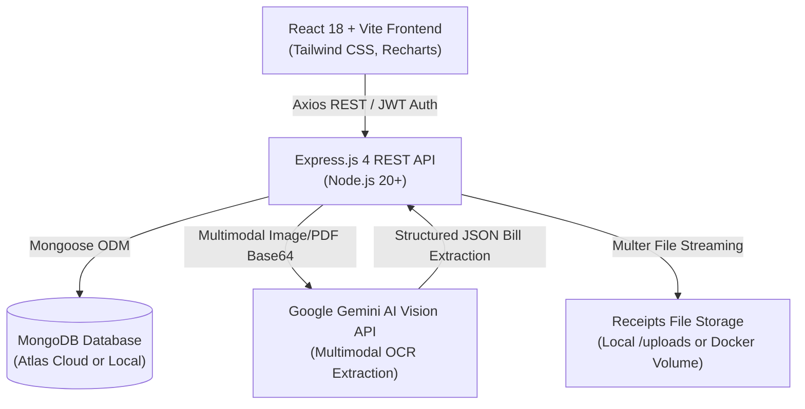

<div align="center">

# 💎 SpendWise
### **Intelligent Personal Finance & Smart Bill Scanning Application**

[](https://react.dev/)
[](https://vitejs.dev/)
[](https://tailwindcss.com/)
[](https://nodejs.org/)
[](https://expressjs.com/)
[](https://www.mongodb.com/)
[](https://ai.google.dev/)
[](https://www.docker.com/)
[](https://opensource.org/licenses/MIT)

<br/>

[](https://vercel.com/new/clone?repository-url=https://github.com/Samarthrh/Spendwise&root-directory=frontend&env=VITE_API_URL&envDescription=Enter%20your%20live%20Render%20backend%20API%20URL%20(e.g.%20https://spendwise-backend.onrender.com/api))
&nbsp;&nbsp;&nbsp;
[](https://render.com/deploy?repo=https://github.com/Samarthrh/Spendwise)

<br/>

*An end-to-end full-stack personal finance web application featuring AI-powered bill scanning, dynamic receipt tables, real-time budgeting, cash flow analytics, and multi-currency tracking.*

[Key Features](#-key-features) • [Live Demo](#-quick-start--local-setup) • [Architecture](#-system-architecture) • [Deployment](#-cloud-deployment-guide) • [API Reference](#-api-endpoints)

</div>

---

## 🌟 Key Features

### 🤖 1. Smart Multimodal AI Bill Scanner
- **Dynamic Format Recognition**: Effortlessly extracts details from physical and digital receipts across diverse industries:
  - 🛍️ **E-Commerce Tax Invoices**: Amazon, Flipkart, Myntra, Ajio, Meesho (HSN/SAC codes, IGST, order IDs)
  - 🛒 **Retail & Supermarket Receipts**: DMart, Smart Bazaar, Reliance Trends, Walmart
  - 🍽️ **Restaurant & Thermal Bills**: Itemized orders, CGST, SGST, roundoffs, neat amounts
  - 💎 **Jewelry Tax Invoices**: Tanishq, Kalyan (Net weight, gross rate, stone charges, hallmark details)
  - 📱 **Telecom & Utility Bills**: Jio, Airtel, electricity, broadband statements
  - 💳 **Digital Payment Slips**: PhonePe, Google Pay, Paytm transaction snapshots
- **Dynamic Editable Table**: Automatically generates contextual columns based on bill type. Allows editing item names, quantities, unit prices, discounts, and tax rates with real-time math recalculation.
- **Discrepancy Detection**: Highlights math discrepancies if printed totals diverge from calculated item sums.
- **Camera & File Upload**: Seamless drag-and-drop file upload (JPEG, PNG, WEBP, PDF) and rear-facing mobile camera capture.

### 📊 2. Real-Time Financial Dashboard
- **Instant Metrics**: Live calculation of Total Monthly Expenses, Total Income, Net Savings Balance, and Budget Limit.
- **Visual Analytics**: Interactive 6-month cash flow trajectory charts and category spending distribution donuts powered by Recharts.
- **Recent Activity Ledger**: Immediate display of scanned bills and recorded transactions with instant status badges.

### 💳 3. Comprehensive Income & Expense Management
- **One-Click Recording**: Fast modal to record both Income (Salary, Investments, Freelancing) and Expenses.
- **Deep Search & Filtering**: Filter by category, payment method (Cash, UPI, Card), transaction type, and date ranges.
- **1-Click CSV Export**: Instant export of financial ledgers to CSV for tax accounting and spreadsheet analysis.
- **Recurring Transactions**: Support for weekly, monthly, and annual recurring entries.

### 🎯 4. Smart Budgeting & Utilization Tracking
- **Monthly Spending Limits**: Set overall monthly spending limits and category-level ceilings.
- **Visual Utilization Gauges**: Dynamic progress bars showing exact percentage of budget consumed.
- **Smart Warnings**: Automatic visual alerts when spending reaches 80% (Warning) or 100% (Exceeded).

### 🌐 5. Global Multi-Currency Support
- Switch seamlessly between **₹ (INR)**, **$ (USD)**, **€ (EUR)**, **£ (GBP)**, **¥ (JPY)**, and more.
- All dashboard cards, tables, charts, and modal inputs dynamically update with the selected currency symbol.

### 🔒 6. Enterprise-Grade Security
- Password hashing with **bcryptjs** (salt rounds: 10).
- Stateless **JWT (JSON Web Tokens)** stored securely with auto-attach interceptors.
- Production-ready error masking and credential redaction.

---

## 🏗️ System Architecture



---

## 🚀 Quick Start / Local Setup

### Prerequisites
- [Node.js](https://nodejs.org/) v18 or higher
- [MongoDB](https://www.mongodb.com/) (or local instance, or free MongoDB Atlas URI)
- [Git](https://git-scm.com/)

### 1. Clone the Repository
```bash
git clone https://github.com/Samarthrh/Spendwise.git
cd Spendwise
```

### 2. Install All Dependencies
```bash
npm run install:all
```
*(This automatically runs `npm install` inside both `backend/` and `frontend/`)*

### 3. Configure Environment Variables
Copy the sample environment file in `backend/`:
```bash
cp backend/.env.example backend/.env
```
Open `backend/.env` and ensure the values match your setup:
```env
PORT=5001
NODE_ENV=development
MONGODB_URI=mongodb://127.0.0.1:27017/spendwise
JWT_SECRET=your_super_secret_jwt_key_here
OCR_PROVIDER=gemini
GEMINI_API_KEY=your_google_gemini_api_key
```

### 4. Start Development Servers
You can launch both the frontend and backend with a single command:
```bash
npm start
```
* **Frontend UI**: [http://localhost:3000](http://localhost:3000)
* **Backend API**: [http://localhost:5001](http://localhost:5001)
* **Health Check**: [http://localhost:5001/api/health](http://localhost:5001/api/health)

*(Alternatively, use `./start.sh` on macOS/Linux)*

---

## 🐳 Docker Setup (1-Command Full Stack)

SpendWise includes a multi-stage `Dockerfile` and `docker-compose.yml` with automated volume mounts for MongoDB and receipt uploads:

```bash
# 1. Set your Gemini API key in your terminal session or .env
export GEMINI_API_KEY="your_api_key_here"

# 2. Build and launch containers
docker compose up -d --build
```
Your full-stack application will be live at **http://localhost:5001** with zero manual database installation required.

---

## ☁️ Cloud Deployment Guide

SpendWise supports **Unified Full-Stack Deployment** (Express serves both the API and the compiled React SPA from a single service) as well as **Split Deployment** (Vercel + Render).

### Method 1: Render.com (Recommended — 1-Click Unified Service)
1. Fork or push this repository to GitHub.
2. Sign in to [Render.com](https://render.com) and click **New +** → **Web Service**.
3. Select your GitHub repository.
4. Configure the service:
   - **Runtime**: `Node`
   - **Build Command**: `npm run build`
   - **Start Command**: `npm run start:prod`
5. Add the following **Environment Variables**:
   | Variable | Value | Description |
   |---|---|---|
   | `NODE_ENV` | `production` | Enables production mode & SPA serving |
   | `MONGODB_URI` | `mongodb+srv://...` | Your MongoDB Atlas connection URI |
   | `JWT_SECRET` | `openssl rand -hex 32` | Secure JWT signing key |
   | `OCR_PROVIDER` | `gemini` | Multimodal AI OCR provider |
   | `GEMINI_API_KEY` | `your_api_key` | Google AI Studio Gemini API Key |
6. Click **Deploy Web Service**. Render provides a free SSL HTTPS link automatically!

---

### Method 2: Split Hosting (Vercel Frontend + Render Backend)
- **Backend (Render)**: Set Root Directory to `backend`, Build Command: `npm install`, Start Command: `node src/server.js`.
- **Frontend (Vercel)**: Set Root Directory to `frontend`, Build Command: `npm run build`, Output Directory: `dist`. Add `VITE_API_URL=https://your-backend.onrender.com/api`. Client-side routing is handled via `frontend/vercel.json`.

---

## 📋 API Endpoints

| Method | Endpoint | Description | Auth Required |
|---|---|---|:---:|
| `POST` | `/api/auth/register` | Register new user account | No |
| `POST` | `/api/auth/login` | Sign in with email & password | No |
| `GET` | `/api/auth/me` | Fetch authenticated user profile | Yes |
| `GET` | `/api/reports/dashboard` | Get calculated metrics, trends & charts | Yes |
| `POST` | `/api/bills/upload` | Upload & scan receipt with Gemini AI | Yes |
| `POST` | `/api/bills/:id/confirm` | Confirm reviewed bill & sync transaction | Yes |
| `GET` | `/api/bills` | Fetch user bills with status filters | Yes |
| `GET` | `/api/transactions` | Fetch transactions with search & pagination | Yes |
| `POST` | `/api/transactions` | Manually record an income or expense | Yes |
| `GET` | `/api/transactions/export/csv` | Download transaction ledger as CSV | Yes |
| `GET` | `/api/budgets/current` | Get current month budget & utilization | Yes |
| `POST` | `/api/budgets` | Set overall & category budget limits | Yes |

---

## 🧪 Testing

SpendWise comes with 19 automated financial math and OCR parsing tests:

```bash
npm test
```

Test coverage includes:
- Floating-point financial rounding accuracy across tax, discounts, and line totals.
- Zero-discrepancy parsing for real-world Amazon, Flipkart, DMart, Swiggy, Tanishq, and restaurant bills.
- Budget threshold calculations (80% warning / 100% exceeded triggers).

---

## 🤝 Contributing

Contributions, issues, and feature requests are welcome!
1. Fork the Project
2. Create your Feature Branch (`git checkout -b feature/AmazingFeature`)
3. Commit your Changes (`git commit -m 'Add some AmazingFeature'`)
4. Push to the Branch (`git push origin feature/AmazingFeature`)
5. Open a Pull Request

---

## 📄 License

Distributed under the **MIT License**. See `LICENSE` for more information.

<div align="center">
  <sub>Built with ❤️ by <a href="https://github.com/Samarthrh">Rojara Samarth (Samarthrh)</a></sub>
</div>
